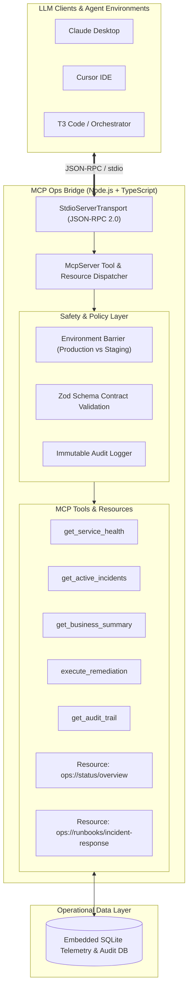

# 🌉 MCP Ops Bridge — Enterprise AI Infrastructure Gateway

[](https://github.com/Alemarpapa/mcp-ops-bridge/actions/workflows/ci.yml)
[](https://www.typescriptlang.org/)
[](https://modelcontextprotocol.io/)
[](https://vitest.dev/)
[](https://nodejs.org/)
[](LICENSE)

An enterprise-grade **Model Context Protocol (MCP)** server engineered to connect autonomous AI agents (Claude Desktop, Cursor, T3 Code) directly to operational telemetry, incident management systems, and infrastructure remediation workflows — built with strict **Safety Guardrails** and **Audit Trails**.

---

## 🏛️ System Architecture



---

## ✨ Key Capabilities

### 1. 🛡️ Guardrailed Remediation (`execute_remediation`)
Automates emergency operations without risking uncontrolled production outages:
* **Production Protection:** Blocked by default if `confirm_production: false`.
* **Bounded Parameters:** Replicas capped and validated with Zod schemas.
* **Audit Trail Integration:** Every attempt (approved or blocked) is logged immutably.

### 2. 📊 Real-Time Telemetry & Incident Intelligence
* **`get_service_health`:** Filters microservices by health (`healthy`, `degraded`, `down`), p99 latency, and error rate.
* **`get_active_incidents`:** Prioritizes P1/P2 operational emergencies.
* **`get_business_summary`:** Correlates infrastructure degradation with business impact (transaction volume and gross revenue).

### 3. 📖 Native MCP Resources
Provides read-only contextual knowledge to LLMs without tool calling overhead:
* `ops://status/overview`: Live snapshot of current services and metrics.
* `ops://runbooks/incident-response`: Standard Operating Procedure (SOP) guiding the model's incident handling behavior.

---

## 🚀 Quickstart

### Prerequisites
* **Node.js:** `>= 20.0.0` (Tested on Node 22)
* **npm:** `>= 10.0.0`

### 1. Installation & Build
```bash
# Clone the repository
git clone https://github.com/your-username/mcp-ops-bridge.git
cd mcp-ops-bridge

# Install dependencies
npm install

# Compile TypeScript
npm run build
```

### 2. Run Tests
```bash
npm test
```
All unit tests and guardrail assertion suites run with Vitest.

Real output (Vitest):

```text
 ✓ should have seeded database with core microservices and incident
 ✓ should verify production service environment and handle guardrail blocking
 ✓ should execute remediation and update service status
 ✓ should log audit record accurately upon execution

 Test Files  1 passed (1)
      Tests  4 passed (4)
```

---

## 🔌 Connecting to MCP Clients

### Claude Desktop Configuration
Add the server configuration to your `claude_desktop_config.json`:

```json
{
  "mcpServers": {
    "ops-bridge": {
      "command": "node",
      "args": ["/home/alejandro/proyectos/01_mcp_ops_bridge/dist/index.js"]
    }
  }
}
```

### Cursor / T3 Code Configuration
In your `.cursor/mcp.json` or project MCP settings:

```json
{
  "mcpServers": {
    "ops-bridge": {
      "command": "npx",
      "args": ["-y", "tsx", "/home/alejandro/proyectos/01_mcp_ops_bridge/src/index.ts"]
    }
  }
}
```

---

## 🧪 Example Agent Interaction

**User:**
> *"The checkout API seems degraded. Investigate the issue, check if revenue is being affected, and take action if necessary."*

**AI Agent Workflow with MCP Ops Bridge:**
1. **Reads** `ops://runbooks/incident-response` to review remediation policy.
2. **Calls** `get_service_health({ status: "degraded" })` $\rightarrow$ identifies `svc-checkout` with 420ms p99 latency.
3. **Calls** `get_business_summary({ limit_days: 1 })` $\rightarrow$ spots payment failure rate elevated to 1.25%.
4. **Calls** `execute_remediation({ service_id: "svc-checkout", action: "scale_replicas", replicas: 10, confirm_production: true, justification: "Peak traffic latency mitigation", operator_id: "ai-operator-lead" })`.
5. **Verifies** `get_audit_trail()` to ensure compliance recording.

---

## 📁 Repository Structure

```
├── data/                  # Embedded SQLite database (generated automatically)
├── src/
│   ├── db.ts              # Database schema definition and seed data
│   ├── index.ts           # Server bootstrap and stdio transport lifecycle
│   └── tools/
│       ├── metrics.ts     # Health and business telemetry MCP tools
│       ├── ops.ts         # Remediation actions and compliance audit tools
│       └── resources.ts   # Contextual runbooks and status resources
├── tests/
│   └── mcp_tools.test.ts  # Vitest test suite validating policies & guardrails
├── package.json           # Scripts and ESM dependencies
├── tsconfig.json          # Strict TypeScript configuration
└── README.md              # Project documentation
```

---

## 👤 Author
**Alejandro** — AI-Augmented Developer & Automation Engineer  
*Specialized in Model Context Protocol (MCP), Multi-Agent Orchestration, and Enterprise Systems.*

## 📄 License
This project is licensed under the MIT License — see the [LICENSE](LICENSE) file for details.
